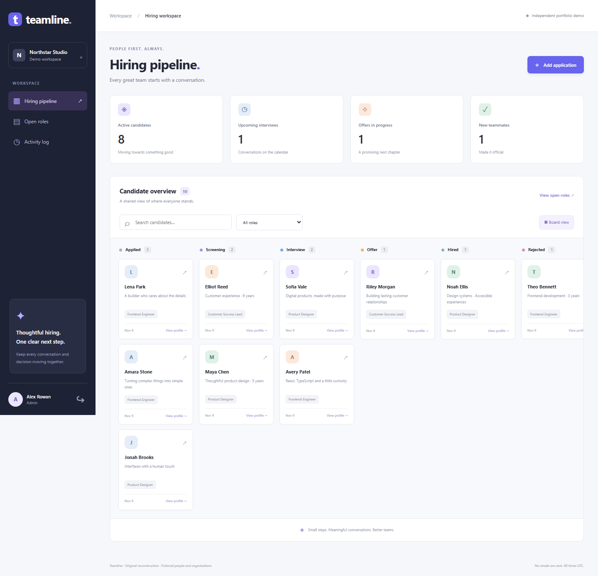

# Teamline

**An independent applicant-tracking reconstruction, newly authored in November 2026.** Teamline is an original Laravel/Livewire demo for a small recruiting team: manage roles and applications, move candidates through a controlled pipeline, and schedule interviews without double-booking candidates or interviewers.

All organizations, people and contact details are fictional. This is newly written portfolio code, not employer source code, a recovered historical repository, or proof of an individual's past assignments. New commits retain their actual creation dates.



## Context and public evidence

The supplied resume reports employment at **LET'S DO YOUR PLAN, August 2023-March 2026**, using Laravel and related technologies. That period is employment context, not this repository's development period.

[Son Banh's public portfolio](https://sonbt.dev/) and [published CV](https://sonbt.dev/Son_Banh_CV_PHP.pdf) identify We-Clutch among his own LDYP work. This is another developer's account. It does not confirm the resume subject's involvement or the project's delivery dates.

[We-Clutch's official site](https://we-clutch.com/) describes recruitment processes, an applicant-tracking/interview tool and API integration. Its copyright year is not evidence of an implementation date. That general domain inspired Teamline's independently designed interface and workflows. We-Clutch describes AI features; **Teamline implements deterministic recruiting workflows and does not claim AI recommendations, external integrations or affiliation**.

## What works

- Organization-isolated recruiter login with administrator, recruiter and read-only demo accounts.
- Livewire candidate search and role filtering, pipeline overview and role administration.
- New applications with fictional `.test` email validation and duplicate prevention per candidate/role.
- Server-enforced pipeline transitions: Applied → Screening → Interview → Offer → Hired, with rejection from active stages.
- Optimistic version checks prevent a stale tab from overwriting a teammate's pipeline change.
- UTC interview scheduling with duration, stage, organization and overlap checks. The same candidate cannot be double-booked across different applications and interviewers.
- Interview cancellation releases availability. Upcoming interviews must be cancelled before advancing to an offer or rejecting the application.
- Atomic audit records for application, role, pipeline and interview changes; an audit storage failure rolls back its associated change.
- Read-only activity history with application-level restrictions and SQLite triggers rejecting log updates/deletes. This is append-only application history, not a cryptographic or administrator-proof audit system.
- Original responsive UI, local CSS/SVG assets, accessible form labels and error/empty states.

No email is sent and no real candidate data is needed. Demo credentials are intentionally public. This local demonstration does not include account registration, production identity management or a real calendar/email provider.

## Run locally

Requirements: PHP 8.5 recommended (locked dependencies require 8.4.1+), Composer 2, and SQLite/PDO SQLite, mbstring, intl, DOM/XML and fileinfo extensions. No Node build is required.

```sh
git clone https://github.com/hi676sweet/applicant-tracking-reconstruction.git
cd applicant-tracking-reconstruction
composer run setup
composer run dev
```

Open `http://127.0.0.1:8065`. Setup installs the locked dependencies, creates a local environment file/application key/SQLite database, migrates and seeds the fictional workspace.

All accounts use password **`demo-password`**:

| Email | Workspace | Access |
| --- | --- | --- |
| `alex@northstar.test` | Northstar Studio | Administrator |
| `sam@northstar.test` | Northstar Studio | Recruiter |
| `viewer@northstar.test` | Northstar Studio | Read only |
| `robin@orbit.test` | Orbit Labs | Separate organization |

The seed includes three Northstar roles, ten Northstar applications, a future demo interview and one isolated Orbit application. All interview times are UTC. Seed timestamps are generated when setup runs, rather than claiming historical work dates. Re-running the seeder preserves existing records. To erase local demo changes and restore fixtures:

```sh
php artisan migrate:fresh --seed
```

## Validate

```sh
composer validate --strict
php artisan test --compact
vendor/bin/pint --test --cache-file=.pint-fresh.cache
php artisan view:cache
```

Use a new Pint cache path when independently checking a changed source tree. GitHub Actions uses a fresh run-specific cache and executes validation, tests, formatting and Blade compilation on PHP 8.5.

Feature tests cover authentication, organization isolation, viewer authorization, duplicate applications, stage/version rules, atomic audit rollback, immutable log guards, interview collisions across roles, adjacent slots, cancellation and invalid schedules. Independent browser checks validate the actual desktop/mobile workflow.

## Implementation notes

Laravel 13, Livewire 4 and SQLite serve a Blade application with local assets. Organizational scope comes from the authenticated user rather than submitted identifiers. Pipeline writes use version comparisons. Interview transactions acquire the organization's SQLite write lock before checking candidate/interviewer availability; overlapping intervals use `start < other_end && end > other_start`, allowing adjacent appointments. Mutations and their audit events commit together.

The application intentionally targets SQLite. Do not assume its transaction/trigger behavior has been validated on another database. Secrets, databases, generated caches, dependencies and setup-check directories are excluded from public source.

MIT licensed. The original Laravel foundation retains its attribution in [LICENSE](LICENSE).
